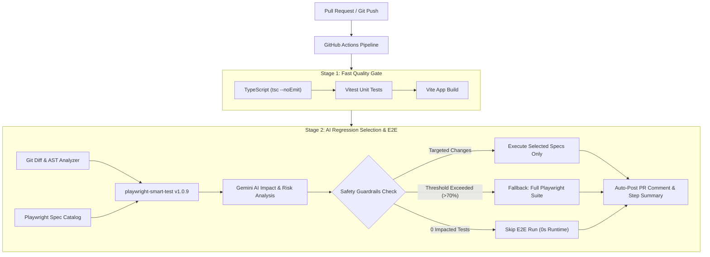

# 🛒 E-Commerce Playwright Demo

[](https://github.com/Ujjwal-S-S/ecommerce-playwright-demo/actions)
[](https://www.npmjs.com/package/playwright-smart-test)
[](https://playwright.dev/)
[](https://react.dev/)
[](https://www.typescriptlang.org/)
[](./LICENSE)

A modern React + TypeScript e-commerce application demonstrating practical testing strategies: fast **Vitest unit tests**, maintainable **Playwright Page Object Models (POM)**, and automated **AI-powered regression test selection** using [`playwright-smart-test`](https://github.com/Ujjwal-S-S/playwright-smart-test) in GitHub Actions CI.

---

## 💡 Overview & Problem Solved

In modern web development, end-to-end (E2E) suites grow rapidly. Running the full browser test suite on every single pull request introduces major challenges:
- **Slow CI Feedback Loops**: Developers wait 15–30+ minutes for regression suites to finish.
- **High Cloud & Runner Costs**: Spinning up browser containers for unaffected features wastes CI minutes.
- **Flakiness Fatigue**: Running unchanged specs unnecessarily increases false-positive failures.

### The Solution Demonstrated Here
This project implements a balanced testing architecture:
1. **Unit & Component Tests (Vitest)**: Instant feedback (<1s) for business logic, discounts, tax calculations, and component rendering.
2. **End-to-End Tests (Playwright + POM)**: Clean, resilient browser tests structured with the Page Object Model pattern.
3. **Smart Regression Selection (`playwright-smart-test` v1.0.9)**:
   - Analyzes git diffs against the target branch (`main`).
   - Maps modified source code to affected test files and component domains using AST patterns.
   - Evaluates risk using Google Gemini to execute **only impacted tests**.
   - Built-in safety guardrails fall back to a full run if core files or too many domains change.
   - Posts a detailed impact report directly to the PR as a comment.

---

## 🏗️ Architecture & CI/CD Workflow



---

## 📂 Project Structure

```text
ecommerce-playwright-demo/
├── .github/workflows/
│   └── smart-regression.yml         # Multi-stage CI pipeline (UT/Build -> AI E2E Selection)
├── src/
│   ├── components/                  # React store components
│   │   ├── Cart.tsx                 # Shopping cart item management
│   │   ├── Checkout.tsx             # Address & promo discount calculation
│   │   ├── Payment.tsx              # Payment method & authorization
│   │   ├── Profile.tsx              # Account settings & preferences
│   │   └── __tests__/               # Vitest component unit tests
│   │       ├── Cart.test.tsx
│   │       ├── Checkout.test.tsx
│   │       ├── Payment.test.tsx
│   │       └── Profile.test.tsx
│   ├── test/
│   │   └── setup.ts                 # Vitest testing-library setup
│   ├── App.tsx                      # Main storefront navigation & state
│   ├── App.css                      # Modern storefront design system
│   ├── main.tsx                     # React application entrypoint
│   └── types.ts                     # Shared TypeScript interfaces
├── playwright/
│   └── e2e/
│       ├── pages/                   # Page Object Models (POM)
│       │   ├── base.page.ts         # Base page wrapper with shared utilities
│       │   ├── cart.page.ts         # Cart selectors & actions
│       │   ├── checkout.page.ts     # Checkout form interactions
│       │   ├── payment.page.ts      # Payment flow & assertions
│       │   └── profile.page.ts      # Profile management helpers
│       └── tests/                   # Playwright E2E specs
│           ├── cart.spec.ts
│           ├── checkout.spec.ts
│           ├── payment.spec.ts
│           └── profile.spec.ts
├── playwright-smart-test.config.json # Component mappings, safety rules & AI configuration
├── playwright.config.ts             # Playwright test configuration & dev server
├── vite.config.ts                   # Vite bundler configuration
├── vitest.config.ts                 # Vitest test runner configuration
└── tsconfig.json                    # Strict TypeScript configuration
```

---

## 🛠️ Key Patterns & Learnings

### 1. Page Object Model (POM) Design
Instead of embedding locators and assertions directly in test specs, each domain page is encapsulated in its own class (`playwright/e2e/pages/`):
- Clean separation of UI selectors from business assertions.
- Updates to HTML markup require modifying only a single page class rather than dozens of tests.

### 2. Dual Testing Pyramid
- **Vitest + Testing Library**: Unit tests cover component edge cases (e.g. invalid promo code handling, total calculations, cart quantity boundaries).
- **Playwright**: Tests real end-to-end user journeys (cart &rarr; checkout &rarr; payment confirmation) inside a real Chromium browser instance.

### 3. Smart Regression Agent (`playwright-smart-test`)
- Configured via [`playwright-smart-test.config.json`](./playwright-smart-test.config.json).
- Declares domain boundaries:
  - `checkout`: `src/**/Checkout*` &rarr; `playwright/e2e/**/checkout*`
  - `payment`: `src/**/Payment*` &rarr; `playwright/e2e/**/payment*`
  - `basket`: `src/**/Cart*` &rarr; `playwright/e2e/**/cart*`
  - `profile`: `src/**/Profile*` &rarr; `playwright/e2e/**/profile*`
- **Safety Fallback**: If changes span more than 8 domains or exceed 70% impact ratio, the agent triggers a full test suite run to prevent regressions.

---

## 🚀 Getting Started

### Prerequisites
- **Node.js** >= 20 (recommended: 22.x)
- **npm** >= 10

### 1. Clone & Install
```bash
git clone https://github.com/Ujjwal-S-S/ecommerce-playwright-demo.git
cd ecommerce-playwright-demo
npm install
```

### 2. Environment Setup (Optional for AI selection)
To test the AI regression agent locally, create a `.env` file from the example:
```bash
cp .env.example .env
```
Add your [Google Gemini API Key](https://aistudio.google.com/):
```env
GEMINI_API_KEY=your_gemini_api_key_here
```

### 3. Run Development Server
```bash
npm run dev
# Starts application on http://localhost:3000
```

### 4. Run Unit Tests (Vitest)
```bash
# Single run
npm run test:unit

# Watch mode
npm run test:unit:watch
```

### 5. Run Playwright E2E Tests
```bash
# Run headless
npm run test:e2e

# Run with interactive UI mode
npm run test:e2e:ui

# Run headed browser mode
npm run test:e2e:headed
```

### 6. Run AI Smart Regression Selection
```bash
# Analyze git diff and view impacted test selections
npm run test:smart:analyze

# Execute only the impacted tests with Playwright
npm run test:smart

# Generate PR comment report
npm run test:smart:comment
```

---

## ⚙️ Configuration Details

### `playwright-smart-test.config.json`
```json
{
  "testDir": "playwright/e2e/tests",
  "testMatch": ["**/*.spec.ts"],
  "pageObjectsDir": "playwright/e2e/pages",
  "components": [
    {
      "name": "checkout",
      "patterns": ["src/**/Checkout*", "playwright/e2e/**/checkout*"],
      "description": "Checkout flow, promo codes, and order calculation"
    },
    {
      "name": "payment",
      "patterns": ["src/**/Payment*", "playwright/e2e/**/payment*"],
      "description": "Payment gateways, tokenization, and invoices"
    },
    {
      "name": "basket",
      "patterns": ["src/**/Cart*", "playwright/e2e/**/cart*"],
      "description": "Shopping cart items, inventory checks, and quantities"
    },
    {
      "name": "profile",
      "patterns": ["src/**/Profile*", "playwright/e2e/**/profile*"],
      "description": "User profile and account settings"
    }
  ],
  "safetyRules": {
    "maxChangedDomainsForFullRun": 8,
    "maxImpactRatioForFullRun": 0.7,
    "smokeTag": "@smoke",
    "docsOnlyPatterns": ["**/*.md", "LICENSE", "**/.gitignore"]
  },
  "ai": {
    "provider": "gemini",
    "model": "gemini-2.5-flash",
    "temperature": 0.2
  }
}
```

---

## 📄 License

This project is licensed under the [MIT License](./LICENSE).
